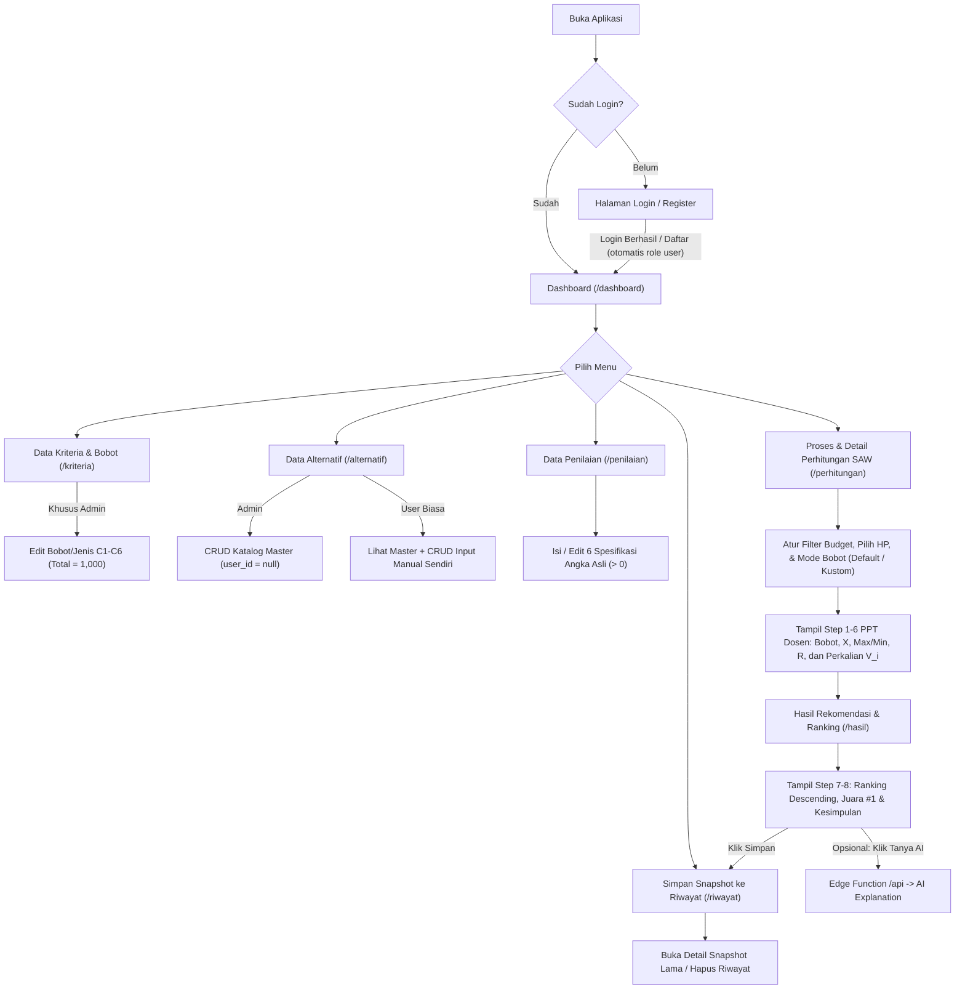

# User Flow & Struktur Halaman - SesuaiDompet

Dokumen ini menjelaskan alur penggunaan aplikasi (**Admin** vs **User Biasa**), daftar halaman beserta isinya, serta pemetaan tampilan proses perhitungan metode **Simple Additive Weighting (SAW)** agar selaras dengan `docs/plan.md`, `docs/prd.md`, dan 8 langkah pada PPT dosen.

---

## 1. Ringkasan Role & Hak Akses

| Aksi / Halaman | Admin (`role = 'admin'`) | User Biasa (`role = 'user'`) |
|---|---|---|
| Login & Dashboard | ✅ Bisa | ✅ Bisa |
| Lihat Kriteria & Bobot Default | ✅ Bisa | ✅ Bisa *(read-only)* |
| Edit Bobot & Jenis Kriteria (`criteria`) | ✅ Bisa *(validasi total = 100%)* | ❌ Tidak bisa ubah master |
| Kelola Katalog Master HP (`user_id = null`) | ✅ CRUD Penuh | 👁️ Hanya lihat & pakai hitung |
| Kelola Input Manual HP Pribadi (`user_id = auth.uid()`) | ✅ Lihat semua | ✅ CRUD milik sendiri |
| Jalankan Perhitungan SAW & Simulasi Budget/Bobot | ✅ Bisa | ✅ Bisa *(tanpa ubah bobot master)* |
| Lihat Detail 8 Langkah Perhitungan SAW | ✅ Bisa | ✅ Bisa |
| Simpan & Lihat Riwayat Perhitungan | ✅ Lihat semua riwayat | ✅ Simpan & lihat milik sendiri |
| Tanya AI Explanation *(opsional)* | ✅ Bisa | ✅ Bisa |

---

## 2. Diagram Alur Utama (User Flow)

---

## 3. Alur Penggunaan Berdasarkan Role

### A. Alur Admin (Persiapan Data & Demo Dosen)
1. **Login** lewat `/login` menggunakan akun Admin.
2. Masuk ke **Dashboard (`/dashboard`)** untuk cek ringkasan jumlah katalog master, jumlah kriteria (`6`), dan juara #1 saat ini.
3. Buka **Data Kriteria & Bobot (`/kriteria`)**:
   - Cek bobot default hasil gabungan 2 jurnal (`C1: 22,9%`, `C2: 7,7%`, `C3: 26,5%`, `C4: 17,7%`, `C5: 15,2%`, `C6: 10,0%`).
   - Saat dosen meminta uji coba ubah bobot saat demo, edit bobot di halaman ini (total wajib `100%` / `1,000`) lalu klik **Simpan**.
4. Buka **Data Alternatif (`/alternatif`)** dan **Data Penilaian (`/penilaian`)**:
   - Tambah/edit/hapus smartphone pada Katalog Master (`user_id = null`).
   - Lengkapi 6 nilai spesifikasi angka asli (`> 0`).
5. Buka **Proses Perhitungan (`/perhitungan`)** dan **Hasil Rekomendasi (`/hasil`)** untuk membuktikan kepada dosen bahwa perubahan bobot/nilai langsung memperbarui seluruh matriks (`X`, `Max/Min`, `R`, `V_i`) dan urutan ranking secara otomatis.

### B. Alur User Biasa (Pencari Smartphone SesuaiDompet)
1. **Register / Login** lewat `/register` atau `/login` (akun baru otomatis menjadi `role = 'user'`).
2. Masuk ke **Dashboard (`/dashboard`)** untuk melihat ringkasan dan rekomendasi default.
3. *(Opsional)* Buka **Data Alternatif (`/alternatif`)** / **Data Penilaian (`/penilaian`)** jika ingin menambahkan **HP input manual pribadi** (`user_id = auth.uid()`) untuk ikut dibandingkan dengan katalog master.
4. Buka **Proses Perhitungan (`/perhitungan`)**:
   - Gunakan **Filter Budget Maksimal** (ciri khas *SesuaiDompet*, misal maksimal Rp 4.000.000).
   - Pilih HP yang dibandingkan (minimal 2 HP dengan spesifikasi lengkap).
   - Pilih pakai **Bobot Default** atau **Bobot Kustom** sesuai prioritas pribadi (tanpa mengubah bobot master Admin).
   - Periksa seluruh langkah perhitungan SAW (Langkah 1–6 PPT Dosen).
5. Buka **Hasil Rekomendasi (`/hasil`)**:
   - Lihat peringkat smartphone terbaik beserta kesimpulannya (Langkah 7–8 PPT Dosen).
   - Klik **"Simpan ke Riwayat"** untuk menyimpan hasil beserta *snapshot* bobot & matriks ke `/riwayat`.
   - *(Opsional)* Klik **"Tanya AI tentang hasil ini"** untuk mendapat ringkasan penjelasan dalam bahasa natural.
6. Buka **Riwayat Perhitungan (`/riwayat`)** kapan saja untuk melihat ulang hasil pencarian sebelumnya.

---

## 4. Peta Navigasi (Sidebar & Routes)

Setelah login, semua halaman menggunakan layout utama dengan **Sidebar Navigasi** di kiri dan **Header** (nama user, badge role `Admin` / `User`, tombol `Logout`) di atas:

1. `/dashboard` — **Dashboard**
2. `/kriteria` — **Kriteria & Bobot**
3. `/alternatif` — **Data Alternatif**
4. `/penilaian` — **Data Penilaian**
5. `/perhitungan` — **Proses Perhitungan**
6. `/hasil` — **Hasil & Rekomendasi**
7. `/riwayat` — **Riwayat Perhitungan**

*(Rute publik sebelum login: `/login` dan `/register`.)*

---

## 5. Detail Isi Setiap Halaman

### 1. Halaman Login & Register (`/login`, `/register`)
* **Form Login:** Input Email, Password, tombol Masuk, dan link menuju halaman Register.
* **Form Register:** Input Nama Lengkap, Email, Password, Konfirmasi Password (otomatis insert ke `public.users` sebagai `'user'`), dan link kembali ke Login.
* **Validasi & Error Handling:** Pesan error jelas jika password salah, email belum terdaftar, atau field kosong.

### 2. Halaman Dashboard (`/dashboard`)
* **Banner Sambutan:** Nama pengguna + badge role (`Admin` atau `User Biasa`) + deskripsi singkat SesuaiDompet.
* **4 Kartu Statistik:**
  1. Total HP Katalog Master (`user_id = null`)
  2. Total HP Input Manual Pribadi (`user_id = auth.uid()`)
  3. Total Kriteria Aktif (`6 Kriteria`)
  4. Total Riwayat Tersimpan
* **Kartu Juara Saat Ini:** Menampilkan smartphone peringkat 1 berdasarkan seluruh katalog lengkap & bobot default.
* **Quick Action Cards:** Tombol pintas menuju `/alternatif`, `/perhitungan`, dan `/riwayat`.

### 3. Halaman Kriteria & Bobot (`/kriteria`)
* **Tabel Kriteria (`C1`–`C6`):** Kolom Kode, Nama Kriteria, Jenis (**Cost** warna oranye/merah, **Benefit** warna hijau), Satuan Input, Bobot (`%` dan desimal 3 angka di belakang koma), serta Baris Total (`100%` / `1,000`).
* **Panel Dasar Penentuan Bobot:** Ringkasan penjelasan singkat bahwa bobot berasal dari penggabungan Jurnal A (*Putri dkk., 2026*) dan Jurnal B (*Ramadhani dkk., 2025*).
* **Form Edit (Khusus Admin):**
  * Tombol **"Edit Bobot / Kriteria"**.
  * Input ubah bobot dan dropdown jenis (`Cost` / `Benefit`).
  * Indikator **Total Bobot Real-time**: menampilkan total saat ini; tombol **Simpan Perubahan** terkunci jika total $\neq 1{,}000$.
  * Tombol **"Reset ke Bobot Jurnal"** untuk mengembalikan nilai default (`0.229; 0.077; 0.265; 0.177; 0.152; 0.100`).

### 4. Halaman Data Alternatif (`/alternatif`)
* **Toolbar:** Kolom pencarian nama smartphone, filter sumber (`Semua`, `Katalog Master`, `Input Manual Saya`), dan tombol **"+ Tambah Smartphone"**.
* **Tabel Daftar Alternatif:**
  * Kolom: No, Kode (`A1, A2, ...`), Nama Smartphone, Sumber (`Master` / `Input Saya`), Status Spesifikasi (`Lengkap` / `Belum Dinilai`), Aksi (`Edit`, `Hapus`).
  * User Biasa hanya melihat tombol `Edit` dan `Hapus` pada baris berlabel `Input Saya`.
* **Modal / Form Tambah & Edit Smartphone:**
  * Input Nama Smartphone (wajib).
  * Sekalian menyediakan input opsional 6 spesifikasi (`Harga`, `Kamera`, `RAM`, `Baterai`, `Penyimpanan`, `AnTuTu`) agar user yang input manual tidak perlu bolak-balik halaman.

### 5. Halaman Data Penilaian (`/penilaian`)
* **Fungsi:** Menampilkan & mengelola nilai angka asli matriks keputusan setiap alternatif terhadap 6 kriteria.
* **Tabel Matriks Spesifikasi:**
  * Kolom: Kode (`A1, ...`), Nama HP, `C1 Harga (Rp)`, `C2 Kamera (MP)`, `C3 RAM (GB)`, `C4 Baterai (mAh)`, `C5 ROM (GB)`, `C6 AnTuTu`, Status, dan Aksi (`Isi / Edit Nilai`).
  * Baris yang masih memiliki kolom kosong ditandai badge **"Belum Dinilai"** dan diberi keterangan tidak ikut perhitungan SAW sampai lengkap.
* **Modal / Form Input Penilaian:**
  * Menampilkan satuan resmi di tiap input (misal: `1 TB = 1024 GB`, harga tanpa titik).
  * Validasi wajib angka `> 0`.

### 6. Halaman Proses & Detail Perhitungan SAW (`/perhitungan`)
Halaman ini dirancang khusus agar **seluruh tahapan algoritma SAW pada PPT Dosen (Langkah 1–6)** terlihat jelas dan bisa diaudit langsung.

* **Panel Pengaturan Sesi (Filter & Bobot):**
  * **Filter Budget Maksimal (SesuaiDompet):** Input/pilihan batas harga maksimal (misal `Semua`, `≤ Rp 3 Jt`, `≤ Rp 5 Jt`, atau input manual).
  * **Pemilihan Alternatif:** Checkbox memilih HP mana saja yang dihitung (default: semua HP lengkap yang lolos filter budget). Tampilkan peringatan jika HP terpilih `< 2`.
  * **Mode Bobot:**
    * `Bobot Default (Admin)` — langsung memakai tabel `criteria`.
    * `Bobot Kustom (Simulasi)` — user mengatur bobot sendiri; jika total $\neq 1$, sistem otomatis menampilkan kotak **Normalisasi Bobot** ($W_j = w_j / \sum w_j$) sesuai **Slide 5 PPT Dosen**.

* **Tampilan Langkah Perhitungan (Berurutan dari Atas ke Bawah):**
  1. **Langkah 1 & 2 — Alternatif & Bobot Aktif:** Ringkasan jumlah HP yang dievaluasi beserta bobot $w_j$ dan jenis (`Cost`/`Benefit`) C1–C6.
  2. **Langkah 3 — Matriks Keputusan ($X$):** Tabel nilai asli spesifikasi setiap HP terpilih.
  3. **Langkah 4 — Nilai Maksimum & Minimum Setiap Kriteria:** Tabel berisi nilai $\max_i x_{ij}$ (ditandai untuk Benefit) dan $\min_i x_{ij}$ (ditandai untuk Cost) di setiap kolom C1–C6.
  4. **Langkah 5 — Matriks Ternormalisasi ($R$):** Tabel nilai $r_{ij}$ dalam format **4 angka di belakang koma** (misal `0,9744`), lengkap dengan keterangan rumus di header kolom ($\min / x$ untuk Cost, $x / \max$ untuk Benefit).
  5. **Langkah 6 — Perhitungan Nilai Preferensi ($V_i$):** Tabel yang menampilkan rincian perkalian $(w_j \times r_{ij})$ untuk setiap C1–C6 beserta hasil penjumlahan akhirnya ($V_i$) dalam format **4 desimal** (persis format Slide 17 PPT Dosen).
* **Footer Aksi:** Tombol **"Lihat Hasil Rekomendasi & Ranking →"** (mengirim/membawa hasil sesi aktif ke `/hasil`).

### 7. Halaman Hasil Rekomendasi & Perankingan (`/hasil`)
*(Menampilkan Langkah 7 & 8 PPT Dosen + Fitur Simpan Riwayat & AI)*
* **Langkah 8 — Champion Card (Rekomendasi Utama #1):**
  * Menampilkan nama smartphone peringkat 1, skor preferensi $V_i$ tertinggi (4 desimal), harga, 6 ringkasan spesifikasi, serta kalimat kesimpulan resmi (mengikuti gaya Slide 19 PPT Dosen).
* **Langkah 7 — Tabel Perangkingan Lengkap:**
  * Diurutkan *descending* dari $V_i$ tertinggi ke terendah (`Peringkat 1, 2, 3, ...`).
  * Dilengkapi *progress bar* visual skor $V_i$ dan detail harga masing-masing HP.
* **Panel Simpan ke Riwayat:**
  * Input judul perhitungan (default otomatis misal `"Rekomendasi SAW - 10 Nov 2026"`) dan tombol **"Simpan ke Riwayat"** untuk menyimpan ke tabel `calculation_histories`.
* **Panel AI Explanation *(Opsional — Phase 7)*:**
  * Tombol **"Tanya AI tentang hasil ini"** → memanggil Supabase Edge Function / Serverless Function `/api` → menampilkan ringkasan alasan kenapa juara #1 unggul berdasarkan kontribusi bobot dan nilai SAW-nya.

### 8. Halaman Riwayat Perhitungan (`/riwayat`)
* **Daftar Riwayat:** Tabel/kartu berisi Judul Perhitungan, Tanggal & Jam, Nama Pembuat *(terlihat semua jika Admin)*, Filter Budget, Smartphone Juara #1, dan Skor Tertinggi ($V_i$).
* **Modal Detail Riwayat:** Klik **"Lihat Detail"** untuk menampilkan kembali *snapshot* bobot yang dipakai dan tabel peringkat dari kolom `weights_used` & `results_snapshot` (tetap akurat meski data katalog diubah di kemudian hari).
* **Aksi Hapus:** Tombol hapus riwayat dengan konfirmasi.

---

## 6. Pemetaan ke Checklist Fitur Minimal Panduan Proyek

| No | Fitur Wajib Panduan Proyek | Halaman di SesuaiDompet |
|---|---|---|
| 1 | Data alternatif | `/alternatif` |
| 2 | Data kriteria | `/kriteria` |
| 3 | Bobot kriteria | `/kriteria` *(Admin edit)* & `/perhitungan` *(simulasi kustom)* |
| 4 | Data penilaian | `/penilaian` |
| 5 | Proses perhitungan | `/perhitungan` *(otomatis via `sawCalculator.js`)* |
| 6 | Hasil rekomendasi / perankingan | `/hasil` |
| 7 | Detail perhitungan | `/perhitungan` *(Step 1–6: $X$, Max/Min, $R$, perkalian $w_j \cdot r_{ij}$, $V_i$)* |
| 8 | Login | `/login` & `/register` |
| 9 | Dashboard | `/dashboard` |
| + | Nilai Tambah *(User Flow & Panduan)* | Input Manual User (`/alternatif`), Filter Budget (`/perhitungan`), Riwayat (`/riwayat`), AI Explanation (`/hasil`) |

